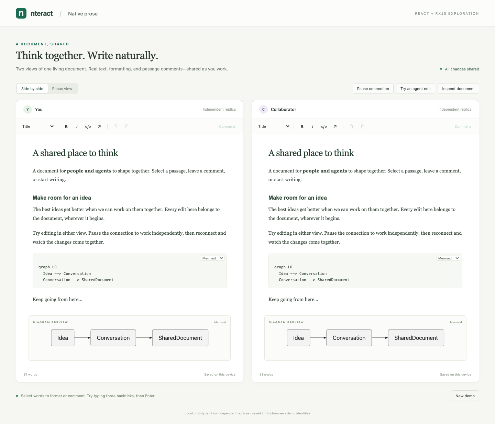

# Wordgard over native Automerge

A runnable first experience for nteract: Wordgard handles browser editing; native Automerge text, marks, and block markers are the document. No ProseMirror or Wordgard OT layer is involved.

An experimental standalone binding, not a production editor or an official nteract release.

This branch, `experiment/react-rxjs`, adds a React shell and an RxJS session layer. The original framework-independent demo remains on `main` at `c9c6ea8`, which is the baseline for the separate Pages/Spaces integration.



## Run

Requires Node 24 and npm. From this folder:

```sh
git clone --branch experiment/react-rxjs https://github.com/rgbkrk/wordgard-automerge.git
cd wordgard-automerge
npm ci
npm run dev -- --port 5197 --strictPort
```

Open http://127.0.0.1:5197/. The server binds only to loopback. The two panes are separate Automerge documents and actors exchanging actual Automerge sync messages inside one page. They are not separate authenticated users or a network deployment.

## Try it

1. Select a passage and use the floating toolbar to format it or add a comment. The other view receives the change and displays your selection.
2. Pause the connection. Format overlapping words and type in both views. Reconnect to merge their independent changes.
3. Type in your view, then in the collaborator view. Undo in your view: the collaborator's insertion remains.
4. Type three backticks in an empty paragraph and press Enter. Choose a code language. Mermaid source remains editable, with a sanitized preview below the document.
5. Use **Try an agent edit** for a targeted native text splice from a third actor. **Inspect document** shows the underlying spans and comments.
6. Reload to restore both local replicas. **New demo** creates another local document and preserves the previous one under its URL.

## The binding

```text
Wordgard transaction → native splice / mark / unmark / updateSpans
                                  ↓
                    Automerge document + sync messages
                                  ↓
native spans → Wordgard changes + cursor mapping → browser view
```

- `src/model.ts`: explicit flat schema, span projection, UTF-16 position maps, safe link values, durable comment anchors.
- `src/replica.ts`: native operations, independent sync states, ephemeral presence with causal heads, comments.
- `src/projection.ts`: remote text and mark changes projected into Wordgard changes. Formatting does not replace the underlying text.
- `src/editor.ts`: editor lifecycle, selection mapping, Wordgard local history, toolbar, comments, presence decorations, diagram preview.
- `src/session.ts`: app-owned replicas, ordered RxJS change/presence feeds, narrow UI projections, persistence, and demo commands.
- `src/react/wordgard-editor.tsx`: stable React host with symmetric mount/unmount cleanup.
- `src/react/session-hooks.ts`: named domain hooks over `useSyncExternalStore` projections.
- `src/react/app.tsx`: React app shell, connection controls, activity, and inspector.
- `src/main.tsx`: creates the session outside React, mounts under Strict Mode, and owns HMR disposal.

Ordinary typing uses `splice`, formatting uses `mark`/`unmark`, and structural changes use `updateSpans`. The adapter checks that each local transaction reproduces the requested Wordgard document before committing it. Incoming changes are excluded from local history and mapped through it. Comments use native cursors and object identity; deleted anchors detach rather than finding a different occurrence of the same words.

Presence carries cursor endpoints, text object ID, and causal heads. A receiver waits until it has those heads before resolving new positions, keeping the last valid cursor visible during the wait. Departure, session/object changes, and expiry clear the retained cursor. Presence and transient remote-edit highlighting are decorations, not persisted formatting. The demo names are not authenticated identities, and the highlight is not durable authorship attribution.

## React and RxJS experiment

The app creates one `DemoSession` outside React. React mounts views over its stable `EditorSession` instances; Strict Mode's extra setup/cleanup cycle creates and destroys views without replacing replicas, their actors, or their sync link. Focus view hides a pane without unmounting it, retaining local history. Actually unmounting a pane releases subscriptions, presence, the heartbeat, and the diagram renderer. Remounting reads the current document; local undo history belongs to the view and resets on a true unmount.

Each `EditorSession` exposes `changes$` and `presence$` as shared, ref-counted RxJS observables over the existing replica events. Document events are delivered synchronously in order, with no debounce and no replay of old edits to a new view. The new view bootstraps from the current Automerge handle. The existing replica still owns all text/mark mutations and causality checks.

The app's UI state uses one private `BehaviorSubject`. Stable, deduplicated projections supply synchronous snapshots to named React hooks (`useConnection`, `useSaveState`, `useActivity`, and others). React never receives the editable document as a controlled `value` prop. Only the inspector subscribes to the document projection, and it mounts on demand. Toolbar, comment forms/cards, and editable content still live inside the imperative `NativeEditor`; moving those controls into React is a separate next step.

The generic `WordgardEditor` wrapper currently consumes the demo's session context for save status. For a nteract host, replace that context/controller with the real session owner and its domain hooks. The demo does not copy nteract's stores or import the monorepo. `model.ts`, `projection.ts`, and `replica.ts` are unchanged from `main`; the integration seam added here is the observable edge and React view lifecycle.

The existing localStorage keys and snapshot format are retained, so documents made in the original demo continue to open. Page hiding saves but does not destroy the app, allowing browser back-forward caching; HMR explicitly unmounts React and disposes the old session.

## Validation

```sh
npm test
npm run build
npx playwright install chromium  # only if Chromium is not already installed
npm run test:browser
```

Eleven model tests cover span/Unicode round trips, mark-only projection, disjoint changes, preserved text identity and cursors, offline convergence, structural splits, deleted comment anchors, presence causality, paragraph-end cursor mapping, pending cursor continuity, and presence lifecycle boundaries. Ten Chromium tests cover overlapping formatting and typing offline, local undo/redo after remote typing, comments and reload, code-fence input and language sync, links and sanitized Mermaid output, selection presence, wide/narrow layout, preservation of unreadable storage, stable layout across successive frames at hard and soft line endings, and cursor visibility while typing ahead of delayed document sync.

Browser tests use one page with two independent replicas. Some selection setup uses Wordgard's API; typing and toolbar actions go through browser input. This does not qualify real operating-system IME input, mobile keyboards, Safari/WebKit, or separate-client network transport.

This branch adds five session tests for synchronous/deduplicated projections, current snapshots across subscription gaps, ordered shared event delivery, restart persistence, and disposal. Two browser tests verify that React rerenders preserve selection/editor identity/undo, and that Strict Mode plus repeated unmount/remount leaves one view per pane without duplicate source subscriptions. Total: 16 model/session tests and 12 browser tests.

## Integration boundary

This is a standalone local spike, not a change to the nteract repository or deployed Pages. It uses the official JavaScript Automerge package with its Rust/WASM runtime; it does **not** yet call nteract's Markdown Rust/WASM projection APIs.

Supported: paragraphs, headings, line breaks, bold, italic, inline code, strike marks, links, and source-backed code blocks. Lists, tables, images, nested containers, and arbitrary rich-text schemas need explicit mappings. Unsupported native block/mark types are rejected, not silently flattened. Only the first Mermaid block is previewed.

Both snapshots are saved in browser localStorage. There is no cross-tab coordination, durable storage service, authentication, permission enforcement, collaborative comment replies, durable attribution, or persistent undo history. Do not open the same demo URL in multiple tabs for concurrent editing; use the two views provided. Browser storage can be cleared or reach quota.

Projection currently reads and diffs the complete document on remote updates and structural edits. It demonstrates semantics, not a large-document performance result. The production bundle is also unoptimized (roughly 6.2 MB JavaScript before gzip on this branch).

The next integration step is to host this binding in an isolated nteract/Pages branch: bind to its existing authoritative rich-text object, replace `LocalLink` with its sync/presence transport, and use its authenticated identity and attribution APIs. Then connect the Rust/WASM layer to native spans and patches for Markdown import/export, preserving source for code and other opaque regions. Avoid routing each keystroke through a Markdown serialization cycle.

Before treating it as the production editor, qualify native IME composition during incoming changes, multi-block clipboard operations, undo under concurrent structural edits, nested block schemas, remote deletions at selections, and performance on representative Pages documents. These are open validation areas, not claimed successes.

## Versions and provenance

Wordgard 0.6.2 and Automerge 3.5.0 are pinned. The source investigation used Wordgard commit `575d653d964b94ee83d7f03af6b043e082c05771` from https://code.haverbeke.berlin/wordgard/wordgard.

`src/mermaid-renderer.ts` is copied from nteract's `src/components/markdown/mermaid-renderer.ts` at commit `c1b691230`, retaining the existing Pele/DOMPurify sanitization and resource policy. Its BSD-3-Clause notice is in `NTERACT-LICENSE`. Dependency licenses remain with their packages.

This experiment is licensed under BSD-3-Clause; see `LICENSE`.
